# Web版の総合動作テスト（2-1、2026-10-18）

対象は開発版 `https://heinekogit.github.io/cycling-book-web-dev/` と開発用Supabase。既存の確認済みテストユーザーでログインしているChromeを使用した。本番Web・本番DBには書き込んでいない。

| 項目 | 実測結果 |
| --- | --- |
| 公開トップ・マイページ | 表示成功。ログイン中のアカウントと非公開ルート2件、実走ログ0件を確認。公開ルート0件の空表示も確認。 |
| 新規ルート作成 | 地図上で直線2点を描き、0.52 kmを確認。Undo/Redo、標高プレビュー、マーカーコメントを画面で確認して保存。開発用DBのルートID `4`へ遷移した。 |
| 編集・再読込 | 説明を更新し、再表示で反映を確認。さらに3点目を加えて1.63 kmに延長し、マイページにも表示された。 |
| マーカー | コメント付きマーカー1件を保存し、詳細画面の地図ポップアップで再読込後も表示された。 |
| 公開前ガード | ホーム地点未設定では公開確認画面が設定を要求し、公開しなかった。 |
| プライバシーゾーンと公開 | 一時的な公共エリアのホーム地点を設定し、元ルートまで約303 m、500 m除外ONを確認。公開プレビューではゾーン内の区間が消え、公開後の距離は1.63 kmから約0.86 kmになった。匿名REST読み取りでは公開ルート1件、マーカー0件、元の非公開形状はHTTP 401。 |
| 非公開へ戻す | 画面で非公開にし、匿名REST読み取りでルート・マーカーとも0件。仮のホーム地点は元の空欄へ戻し、再読込後も空欄と確認。検証用ルートID `4`は**非公開のまま開発用DBに残す**。 |
| 写真アップロード | 再試験成功。既存マーカーに合成PNG（320×240 px）を1枚追加し、「マーカーと写真を保存」で保存完了。編集画面の再読み込み後も1枚を確認し、詳細画面のマーカーポップアップとルート写真一覧で市松模様の画像を確認。ルートID `4`は非公開のまま。 |
| 写真のプライバシー除外・削除 | 仮ホーム地点（35.682, 139.730）から500m以内を除外して開発版のルートID `4`を一時公開。匿名RESTではルート1件、マーカー0件、写真0件。所有者向け公開表示の写真一覧には1枚が残る表示不整合を発見。非公開に戻した後、合成写真を削除して保存し、再読込後にマーカー・詳細画面とも0枚を確認。仮ホーム地点も空欄に復帰した。 |
| 道路に沿う描画・ポイント編集 | 2026-10-19に開発版の非公開ルートID `4`で確認。道路に沿う4点目の追加、終点移動、中間点追加、その中間点の削除がいずれも保存・再表示できた。最終状態は4ポイント、4.05 km、非公開。 |
| GPX取込・実走ログ表示 | 2026-10-19に個人情報を含まない合成GPX（3地点、標高・時刻付き）を取り込み。非公開マイルートID `5`と実走ログID `2`を保存し、双方の詳細画面を再読み込み後も表示できた。実走ログはマイページ一覧にも表示された。 |
| 新規登録・メール確認・再設定・退会 | 2026-10-19に開発版の専用空アカウントで確認。確認メール経由で登録し、再設定メールからパスワードを更新。更新後の再ログインに成功。退会後は未ログイン状態となり、開発用Authユーザー検索でも0件を確認。 |

テスト中、プロフィールで緯度・経度が空欄のとき `Number('')` が `0` になるため、空欄保存で `(0,0)` が登録され得る不具合を発見した。`ProfilePage.tsx`で空欄を`null`として扱う修正を`develop`コミット`dc8a54b`に入れた。開発版Pagesコミット`0e2e631`（Actions実行`39118938769`、デプロイ`7153180290`）へ公開し、公開接続先検査と空欄保存→再読込を確認した。本番Webはまだこの修正を含まない。

## 写真テスト再開（2026-10-18）

- Chrome拡張の「ファイルのURLへのアクセス」をユーザーがONにした後、開発版 `/routes/4/edit` で再試験した。開発用アカウントの既存ログインセッションが有効で、ログイン画面への再入力は不要だった。
- 対象は「E2E検証用ルート 2026-10-18」（ID `4`）、既存マーカー「E2E検証マーカー。写真もテスト用の図形です。」。追加前は写真0枚。
- 前回用意した `cycling-book-e2e-test-20261018.png`（320×240 px、緑色の市松模様、個人情報を含まない合成画像）を1枚選択。今回はファイル選択が成功し、「1枚の写真を追加しました。保存ボタンでアップロードします。」を確認した。
- 「マーカーと写真を保存」を押し、「マーカーと写真を保存しました。」を確認。編集画面を再読み込みし、同じマーカーの写真数が1枚で、画像が再表示されることを確認した。
- 詳細画面 `/routes/4` でも「このルートは非公開です」、ルート写真「1枚」、既存マーカーのポップアップ内の市松模様を確認。写真リンクのIDは `4ddfa623-55e9-48a4-870f-ee2b33db5c83`。距離1.63 km、編集画面の3ポイントとコメントも維持されている。
- 写真1枚を検証用ルートに残した。公開操作、写真削除、プライバシー除外の試験は今回行っていない。本番環境への操作・変更は行っていない。

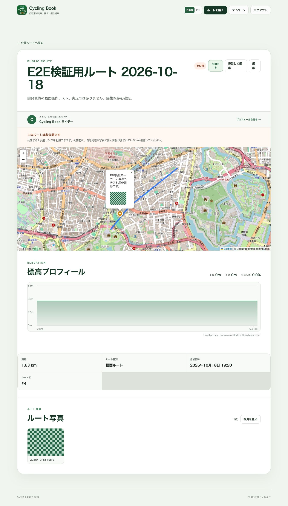

## 写真のプライバシー除外・削除（2026-10-18）

- 開発用プロフィールに仮ホーム地点「E2E写真除外テスト用・仮地点」（緯度35.682、経度139.730）を設定。ルートまでの最短距離は約23mで、500m除外をONにして一時公開した。公開表示の距離は1.63kmから1.03kmになり、地図上のマーカーは消えた。
- 開発用Supabaseへの認証なしREST読み取りでは、公開ルートID `4`が1件、同ルートのマーカーと写真は各0件。一般閲覧者向けのデータ取得では写真が除外されることを確認した。
- **表示不整合**：ログイン中の所有者が見る公開版ルート詳細では、プライバシーフィルター適用後の表示と案内されているのに、「ルート写真」に市松模様の1枚が残った。匿名閲覧者に同じ画像が表示されることを示す結果ではない。画面証跡は下記。修正と再試験が必要。
- ルートを再び非公開にし、詳細画面で「非公開」、元の距離1.63kmを確認。その後、既存マーカーから合成写真を削除して「マーカーと写真を保存」。編集画面の再読み込み後にマーカー写真0枚、詳細画面でもルート写真0枚を確認した。マーカー本体とコメントは残した。
- 仮ホーム地点の名称・緯度・経度を空欄にして保存し、再読み込み後も3項目が空欄であることを確認した。最終状態は開発用ルートID `4`が非公開、写真0枚、ホーム地点未設定。本番環境には操作していない。

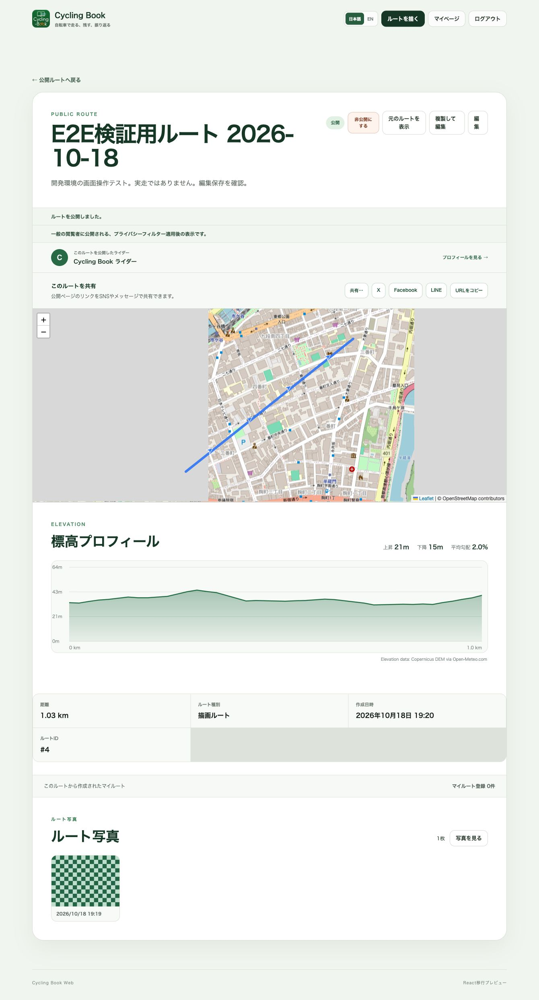

## 写真一覧の表示修正・再試験（2026-10-18）

- 原因は、公開版の地図では `is_privacy_hidden` の写真を除外していたのに、詳細ページの写真一覧には全件を渡していたこと。公開表示の写真一覧・写真ビューアに同じ除外を適用し、公開ページの共有画像候補からも除外写真を外した。ソースコミットは `1a66300`。
- `npm run lint`と開発モードのビルドが成功。開発Pagesコミット`23ec2d7`、Actions実行`39134691461`、デプロイ`7155693635`で`check:pages`が成功し、開発用Supabaseへの接続と公開ファイルを確認した。本番版には反映していない。
- 同じ既存マーカーに合成PNGを再追加し、仮ホーム地点（35.682、139.730）から500m除外ONで一時公開した。所有者の**公開表示**ではルート写真0枚、元のルート表示では1枚。再び公開表示へ切り替えると0枚に戻り、写真ビューアの`?view=public`でも0枚を確認した。
- 検証後、ルートを非公開に戻し、再試験用の合成写真を削除した。仮ホーム地点の名称・緯度・経度も空欄に戻し、再読み込み後に空欄を確認した。最終状態はルートID `4`が非公開、写真0枚、ホーム地点未設定。

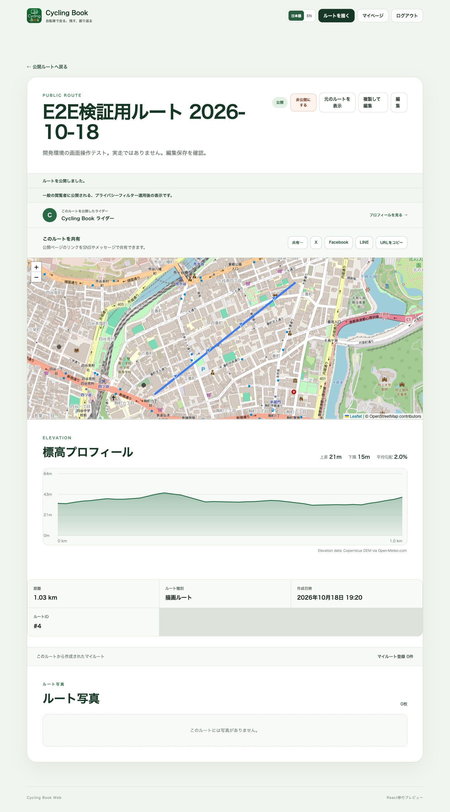

## ルート編集操作の再試験（2026-10-19）

- 開発版の既存非公開「E2E検証用ルート 2026-10-18」（ID `4`）を使用。開始時は3ポイント、1.63 km、既存マーカー1件、写真0枚。
- 「道路に沿う」「自転車」で4点目を地図上に追加。「道路に沿うルートを計算しています…」の後、直線ではない道路経路と4ポイント、3.97 kmを確認して保存。詳細画面を再読み込み後も3.97 km、再編集で4ポイントを確認した。
- 「ポイント移動」で終点をドラッグし、前後の道路経路が再計算されて4.05 kmに変化。保存後の詳細画面でも4.05 kmを確認した。
- 「中間点追加」でルート線上をクリックし、「ルート形状は変更していません。」の表示、5ポイント、距離4.05 kmを確認。保存後の再編集でも5ポイントだった。
- 「ポイント削除」で追加した中間点をクリック。道路経路の再計算後に4ポイントへ戻り、保存後の再編集でも4ポイント、4.05 km。既存マーカー1件と写真0枚は維持された。
- 最終状態は開発用ルートID `4`が**非公開**、4ポイント、4.05 km、既存マーカー1件、写真0枚。本番環境は操作していない。

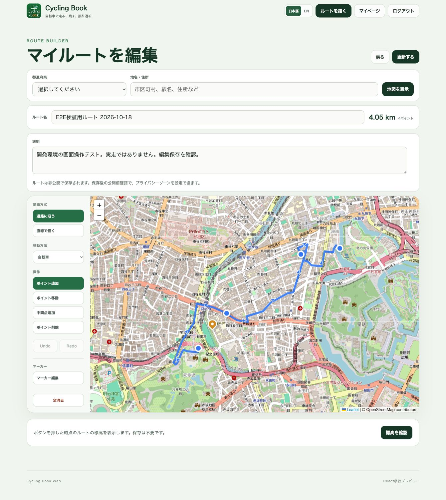

## GPX取込・実走ログ表示（2026-10-19）

- 開発版 `/import/gpx` で[合成GPX](evidence/cycling-book-e2e-20261019.gpx)を選択。3地点、距離0.29 km、開始日時2026/10/19 9:00、標高付き地点3/3と地図・標高プロフィールを確認した。GPXは東京付近の架空テスト軌跡で、個人情報を含まない。
- 「マイルート」として保存すると `/routes/5` に遷移。`E2E合成GPX 2026-10-19`、0.29 km、非公開を確認し、ページ再読み込み後も同じ内容を確認した。
- 同じGPXを「実走ログ」として `E2E合成実走ログ 2026-10-19` の名前で保存すると `/runs/2` に遷移。開始9:00・終了9:02、0.29 km、走行時間2分、平均速度8.6 km/h、標高プロフィールを確認した。ページ再読み込み後も表示された。
- マイページの実走ログ一覧で新規ログID `2` が0.29 km・2分として表示された。既存ログID `1` も一覧にあり、変更していない。合成ルートID `5`と合成ログID `2`は開発用DBに残した。本番環境は操作していない。

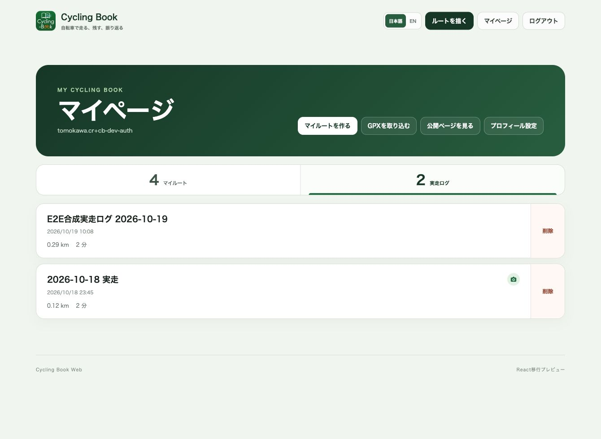

## 認証フロー再試験の準備（2026-10-19）

- 開発版でログイン中の既存テストアカウントを維持したまま、`/signup`、`/forgot-password`、`/reset-password`、`/delete-account` の画面表示を確認した。新規登録と再設定申請では、空欄送信時にブラウザの必須入力案内が表示された。
- 退会画面では現在のパスワードと削除確認の入力が必要で、未入力時は「退会する」が無効。既存テストアカウントにはルートと実走ログがあるため、退会操作はしていない。
- この時点では新規登録・確認メール・再設定メール経由のパスワード更新・空のテストアカウントの退会は未実施。認証情報の入力・変更と不可逆な削除を伴うため、専用の開発用アカウントで続けて実測する。本番環境は操作していない。

## 新規登録・メール確認と再設定リンク（2026-10-19）

- ユーザーが開発版 `/signup` で専用のテスト用アカウントを登録。画面に「登録を受け付けました。」と表示され、Supabase Authから確認メールが到着した。確認メールのリンク先は開発版 `/auth/callback` を指定していた。ユーザーがリンクを開くと開発版 `/mypage` に遷移し、新規アカウントのマイルート0件・実走ログ0件を表示。再読み込み後もログイン状態と空の一覧を確認した。
- 同アカウントで開発版 `/forgot-password` から再設定メールを1通申請。送信完了表示とメール到着を確認した。メールのリンク先は開発版 `/reset-password` を指定し、リンクを開くと新しいパスワードと確認欄がある画面に到達した。認証リンクのトークンやパスワードは記録していない。本番環境は操作していない。
- ユーザーが新しいパスワードを入力・更新し、画面に「パスワードを更新しました。」と表示された。その後ログアウトするとナビゲーションが未ログイン状態に変わり、ログイン画面を表示できた。パスワードは記録していない。
- ユーザーが新しいパスワードで再ログインし、開発版トップに当該テストアカウントでログイン中と表示された。マイページでも本人のマイルート0件・実走ログ0件を確認した。退会画面は表示でき、現在のパスワードと削除確認が未入力のため退会ボタンは無効。退会はまだ実行していない。
- ユーザーが専用の空アカウントの退会を実行。開発版 `/signup?withdrawn=1` に「退会が完了しました。」と表示され、ナビゲーションは未ログイン状態になった。`/mypage` に直接移動しても「ログインが必要です」と表示された。開発用Supabase `cycling-book-dev` のAuthenticationユーザー一覧で、同テスト用メールアドレスの検索結果が0件であることを確認した。旧パスワードでのログイン試行はしていない。本番環境は操作していない。

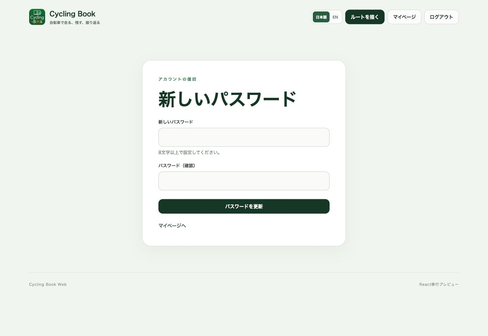

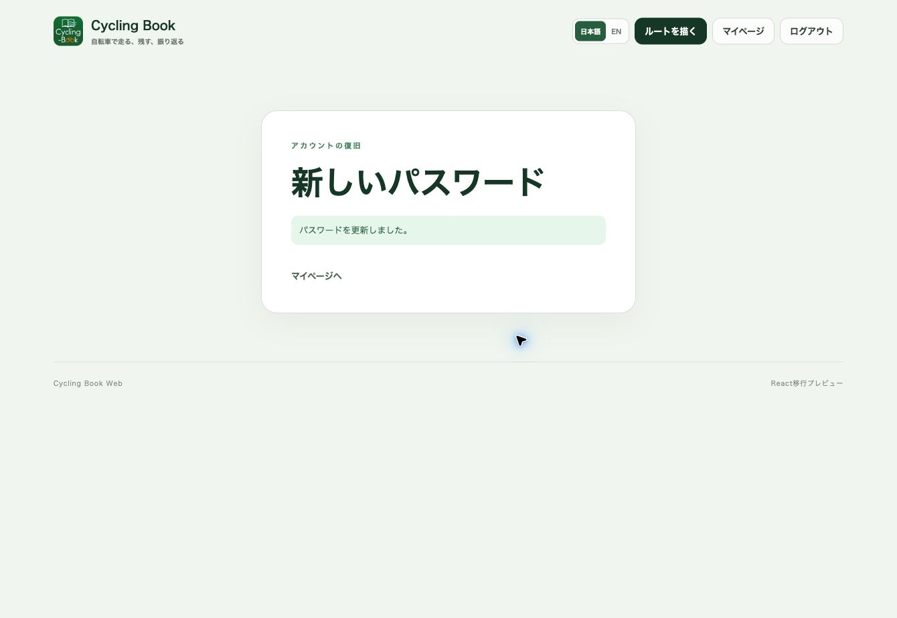

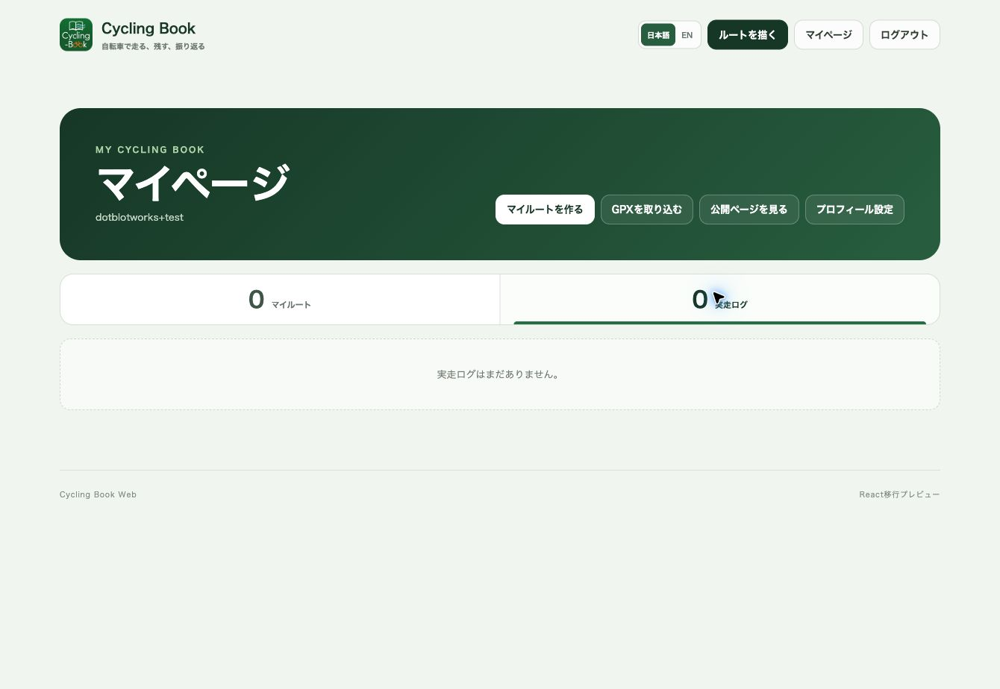

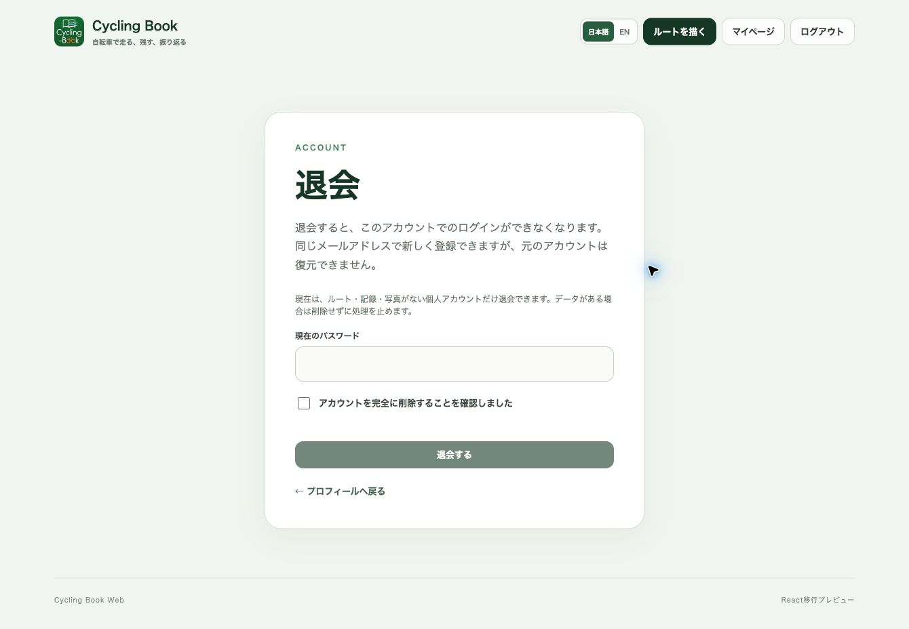

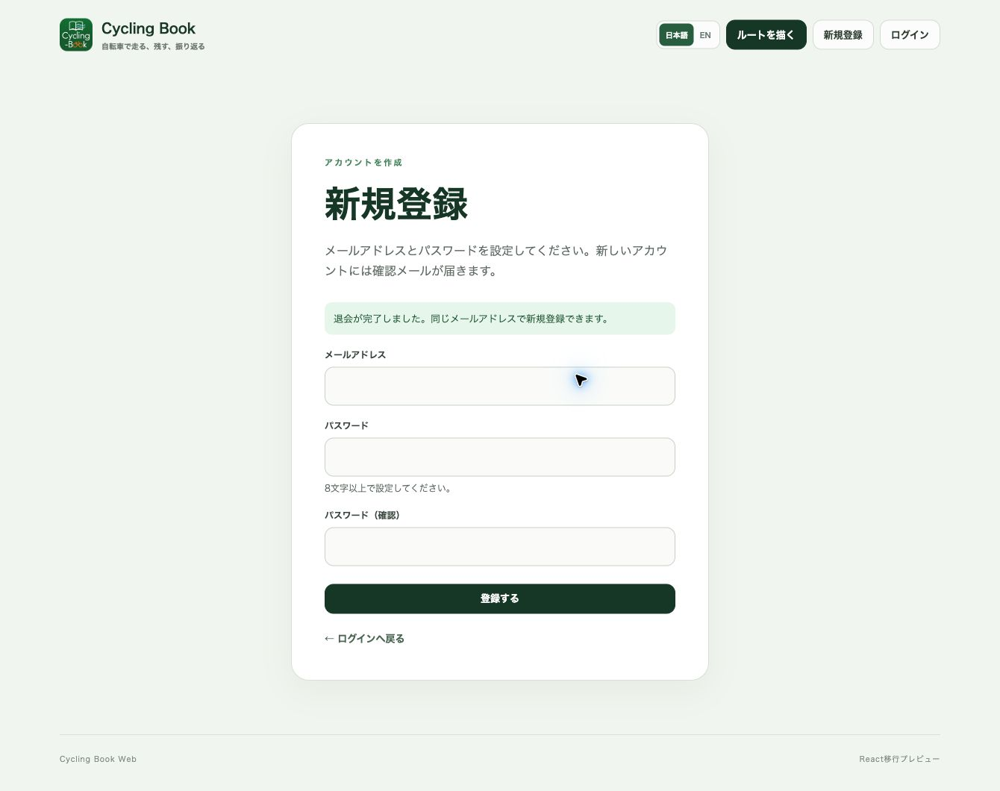

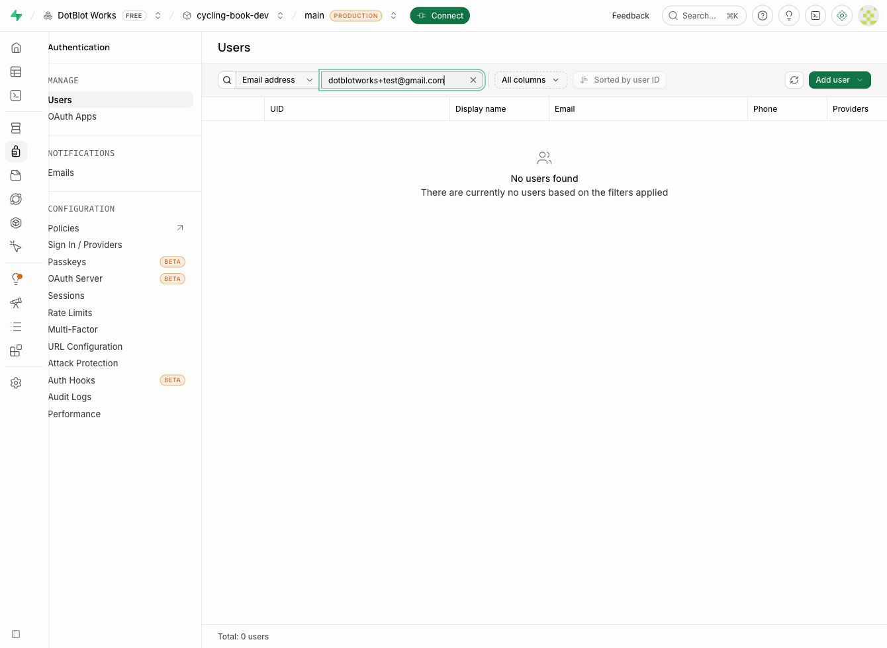

## 表示・ブラウザ検証（2026-10-19）

- 開発版トップをChromeの320、390、720、768、1024、1440px幅で確認。主見出しは720px以上で1行、狭幅では自然に折り返し、どの幅でも横スクロールはなかった。境界の470・471px幅も確認した。
- 320px幅で上部ナビの「ルートを描く」「新規登録」「ログイン」が細く折り返される問題を発見。470px以下では言語切替を上段、3つのリンクを下段に配置し、リンクの文字サイズを12pxに調整。日本語は各リンク1行、英語は必要に応じて2行で読み取れることを確認した。ログイン・新規登録画面も320px幅で横はみ出しなく表示された。
- 開発Pagesコミット`0ec082a`、[Actions実行39263826110](https://github.com/heinekogit/cycling-book-web-dev/actions/runs/39263826110)、デプロイ`7175620940`で`check:pages`が成功。公開後のChrome 320px幅で修正済みナビと横スクロールなしを再確認した。Safariのデスクトップ幅でも開発版トップと公開ルートの空表示を確認した。本番版には反映していない。

## 見出し・一覧密度の調整（2026-10-19）

- トップ、ルート詳細、編集、写真、プロフィール、マイページの見出し文字と縦余白を縮小。公開ルートとマイページのルート欄は行間・カード内余白を詰め、狭幅のマイページ操作ボタンは2列に配置した。
- 開発版Pagesコミット`b0ff648`、[Actions実行39269611630](https://github.com/heinekogit/cycling-book-web-dev/actions/runs/39269611630)、デプロイ`7176546122`で`check:pages`が成功。公開後のトップをChromeのPC幅と390px幅で確認し、横はみ出しはなかった。
- マイページは同じCSSと画面構造の一時プレビューで320〜1340px幅を確認。390px幅では先頭2件のルート欄が844px高の画面内に入り、横はみ出しはなかった。この時点ではログイン後の実ページでの再確認は未実施。本番版には反映していない。

## ログイン後マイページの実表示（2026-10-20）

- 開発用アカウントで開発版 `/mypage` にログインし、マイルート4件と実走ログ2件を確認。ルート一覧には長い英数字の名前を含む4件が表示され、非公開バッジ、日時、距離、種別、削除ボタンを読み取れた。
- ChromeのPC幅、390px、320px幅でマイルートを確認。390px・844px高では先頭2件が画面内に入り、320pxでは長い名前がカード内で折り返された。実走ログも390px・320px幅で2件を確認し、写真ありの表示、距離、時間、削除ボタンを読み取れた。ルート・実走ログのいずれも320pxと390pxで文書幅は画面幅と一致し、横スクロールはなかった。
- 閲覧とタブ切り替えのみ実施。ルート・実走ログの編集や削除はしていない。本番版は操作していない。この表示密度の調整は、実データを用いた検証上の区切りとする。

## Safariでのログイン後表示（2026-10-20）

- MacのSafariで開発版にログイン済みの状態からマイページを開き、Chromeと同じマイルート4件・実走ログ2件を確認。両タブを切り替えて、それぞれの一覧内容が表示された。
- 非公開の「E2E検証用ルート 2026-10-18」（ID `4`）の詳細を開き、非公開表示、4.05 km、写真0枚を確認。ページ再読み込み後もログイン状態と詳細表示が維持され、マイページに戻って4件・2件の件数を再確認した。データの編集・削除・公開はしていない。本番版は操作していない。
- 表示文言の軽微な不整合を発見。非公開ルートの詳細でも小見出しが `PUBLIC ROUTE` と表示される。非公開バッジと説明文は正しい。別途修正対象とする。

## iPhone実機とiOS版の開発データ共有（2026-10-20）

- 接続したiPhone 16（iPhone17,3）でCycling Bookアプリの起動を確認。iPhone Safariは開発版 `/mypage` にログイン済みで、マイルート4件・実走ログ2件を表示した。非公開ルートID `4`の詳細も開け、ルート名・非公開表示が一致。画面上の文字と操作ボタンに明らかな横はみ出しは見られなかった。
- iOSアプリでも同じ開発用アカウントでマイルート4件を表示。Web側の「E2E検証用ルート 2026-10-18」が非公開・4.05 kmで一致し、詳細の地図にルート線とマーカーピンが表示された。走行履歴2件もWebと名前・距離が一致し、合成実走ログは0.29 km・2分、もう1件は0.12 kmで写真ありの表示だった。閲覧のみで、走行開始・公開・編集・削除はしていない。本番環境は操作していない。
- **iOS版の表示不具合を修正・再確認:** 合成実走ログID `2`の軌跡はWeb詳細で表示されるが、iOSアプリ詳細では「軌跡データがありません」「記録点0点」と表示されていた。原因はWebのGPX取込が保存する`Feature`形式のGeoJSONをiOS側が読めなかったこと。iOS版`src/lib/run-history-model.ts`で`Feature.geometry`を読む修正を加え、同形式の回帰テストを追加した。iOS版のテスト33件・型チェック・変更ファイルのlintは通過。修正を含むRelease版を同じiPhone 16へ上書きインストールし、同じ開発用アカウントの走行履歴からログID `2`を再表示。地図と開始・終了ピンが現れ、記録点が`0点`から`3点`になった。距離0.29 km・走行時間2分も維持された。
- マーカーピンは地図上に表示されたが、吹き出し内のコメント・写真は今回確認できなかった。iPhone Safariの編集・保存とiOSアプリからWebへの書き込みも未実施。

## iOS版マーカー吹き出しの手動確認（2026-10-24）

- ユーザーがiPhoneのCycling Bookアプリで、非公開の「E2E検証用ルート 2026-10-18」のマーカーピンをタップし、コメントの表示と、×または地図タップによる吹き出しの閉じる操作がともに成功したと報告した。Codex側の画面操作接続は起動できず、画面の直接確認やスクリーンショット取得はできなかった。
- 検証用マーカーの写真は現在0枚のため、吹き出し内の写真表示・拡大は未確認。今回、本番環境への操作・変更は行っていない。

## 非公開ルート見出しの表示修正（2026-10-24）

- 2026-10-20のSafari検証で見つかった、非公開ルート詳細にも小見出し`PUBLIC ROUTE`が出る不整合を修正した。`RouteDetailPage.tsx`で公開状態に応じて`PUBLIC ROUTE`または`PRIVATE ROUTE`を表示する。
- ソースコミット`30d5a17`。ローカルの`npm run lint`と`npm run build`は成功。開発Pagesコミット`193c6a3`、[Actions実行40100435590](https://github.com/heinekogit/cycling-book-web-dev/actions/runs/40100435590)、デプロイ`7299571307`は成功し、`check:pages`でHTTPS・SPA fallback・開発用Supabase参照を確認。配信されたルート詳細JSに両見出しが含まれることも確認した。ユーザーがログイン済みSafariで開発版の非公開ルートID `4`を再読み込みし、小見出しが`PRIVATE ROUTE`に変わったと報告した。Codex側の画面操作接続は起動できず、画面を直接確認していない。本番環境は変更していない。

## iPhone Safariでの編集・保存（2026-10-24）

- iPhoneミラーリングで、ログイン済みのiPhone Safariから開発版の非公開ルートID `4`を開いた。編集画面に元のルート名、説明、4ポイント、4.05 kmが表示された。
- ルート名の末尾に検証用の英小文字`x`を一時追加して「更新する」を実行。詳細画面に変更後の名前と`PRIVATE ROUTE`・非公開バッジが表示され、Safariで再読み込みしても名前が維持された。
- 再編集で末尾の`x`だけを削除し、元の「E2E検証用ルート 2026-10-18」に戻して保存。詳細画面と再読み込み後の双方で元の名前、説明、非公開状態を確認した。編集中の距離は4.05 km・4ポイントのままだった。公開操作はせず、本番環境には触れていない。
- iPhoneミラーリング経由の日本語長文入力は文字が欠けたため、その入力は保存せず、再読み込み時の下書き復元をキャンセルして破棄した。保存・再表示の確認には短い英字を使用した。

## 未完了の確認

- iPhone実機での開発版WebとiOS版の読み取り共有、およびiOS版のGPX実走軌跡表示の再実機確認は完了。マーカー吹き出しのコメント表示・閉じる操作と、開発版Safariの非公開ルート見出し修正はユーザー報告で確認。iPhone Safariでの非公開ルート編集・保存・再表示も実機で確認済み。写真表示・拡大と、iOS版からWebへの書き込み確認が残る。

したがって**2-1は作業中**。確認済みの範囲をもって「総合動作テスト完了」とはしない。
